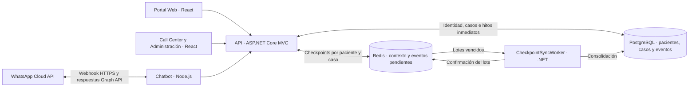
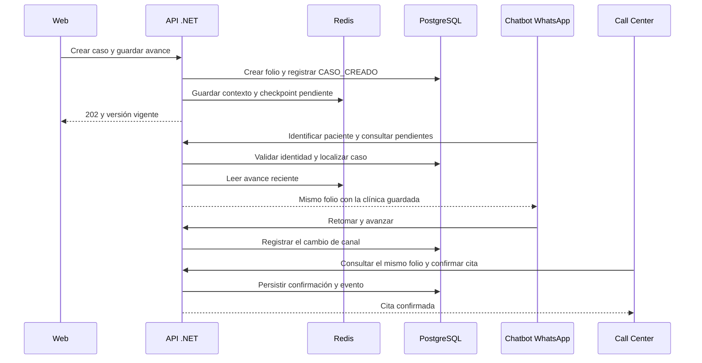
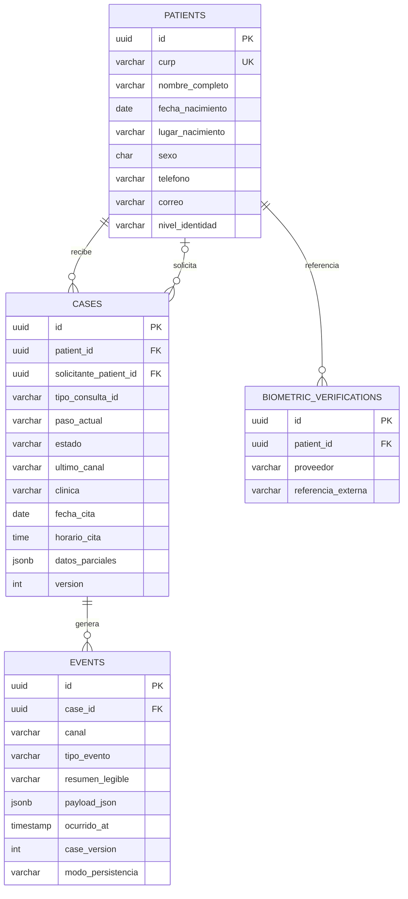

# OmniCanal Salud Digna

Prototipo de TecNM HackaTec para retomar **el mismo trámite** en Web, WhatsApp y Call Center. Los tres canales comparten el catálogo de servicios, la identidad del paciente y el estado del caso. Administración consulta el avance y la línea de tiempo por folio. Las citas y los pagos son simulados.

## Requisitos en Windows

- Git y PowerShell.
- SDK de .NET 10.
- Node.js 22.12 o posterior y npm.
- PostgreSQL en marcha, con pgAdmin o `psql`.
- Docker Desktop con contenedores Linux para ejecutar Redis.
- Para WhatsApp, ngrok y una app de Meta con un emisor de prueba y los destinatarios verificados.

Ejecuta los comandos desde la raíz del repositorio. Usa terminales separadas para el backend, el frontend, el chatbot y ngrok.

## 1. Configurar PostgreSQL y cargar pacientes

En PowerShell, cambia el usuario y la contraseña de ejemplo por los de tu instalación local. El proyecto ya tiene un identificador de User Secrets.

```powershell
dotnet user-secrets set "ConnectionStrings:SaludDigna" "Host=localhost;Port=5432;Database=Salud Digna;Username=postgres;Password=TU_CONTRASEÑA" --project Backend

$env:DOTNET_ENVIRONMENT = 'Development'
dotnet tool restore
dotnet build Backend
dotnet tool run dotnet-ef database update --project Backend --no-build
```

EF Core puede crear la base si el usuario de PostgreSQL tiene permiso. Si carece de ese permiso, crea primero la base **Salud Digna** en pgAdmin. Los secretos de ASP.NET Core quedan fuera del repositorio, en `%APPDATA%\Microsoft\UserSecrets\<UserSecretsId>\secrets.json`.

Carga los tres pacientes ficticios de la demo con el mismo usuario de PostgreSQL. Si `psql` no está en el PATH, abre el [script de pacientes](Backend/Data/Seeds/pacientes-ficticios.sql) en **Query Tool** de pgAdmin sobre la base **Salud Digna** y ejecútalo ahí.

```powershell
psql -h localhost -p 5432 -U postgres -d 'Salud Digna' -v ON_ERROR_STOP=1 -c "SET client_encoding TO 'UTF8'" -f '.\Backend\Data\Seeds\pacientes-ficticios.sql'
```

## 2. Iniciar Redis y el backend

Con Docker Desktop abierto, crea el contenedor una vez. El volumen conserva el archivo de persistencia de Redis entre arranques.

```powershell
docker run -d --name salud-digna-redis -p 127.0.0.1:6379:6379 -v salud-digna-redis:/data redis:8 redis-server --appendonly yes --appendfsync everysec --maxmemory-policy noeviction
```

En sesiones posteriores, usa `docker start salud-digna-redis`. El perfil `SaludDigna.Backend` arranca en `Development` y usa Redis en `127.0.0.1:6379`.

```powershell
dotnet run --project Backend --launch-profile SaludDigna.Backend
```

Comprueba [la API](http://localhost:5080/health), [Redis](http://localhost:5080/health/redis) y [el catálogo](http://localhost:5080/api/tipos-consulta). El chequeo de Redis y el catálogo deben responder con HTTP 200. La carga de pacientes se valida iniciando sesión con uno de los datos de prueba.

## 3. Configurar los accesos de prueba y arrancar el frontend

Para una instalación nueva, genera tres claves locales desde PowerShell. Si ya tienes claves configuradas, reutiliza sus valores y actualiza los archivos locales correspondientes.

```powershell
$advisorKey = [guid]::NewGuid().ToString('N') + [guid]::NewGuid().ToString('N')
$adminKey = [guid]::NewGuid().ToString('N') + [guid]::NewGuid().ToString('N')
$chatbotKey = [guid]::NewGuid().ToString('N') + [guid]::NewGuid().ToString('N')

dotnet user-secrets set 'DemoIdentity:AdvisorKey' $advisorKey --project Backend
dotnet user-secrets set 'DemoIdentity:AdminKey' $adminKey --project Backend
dotnet user-secrets set 'Chatbot:ApiKey' $chatbotKey --project Backend

@"
SALUD_DIGNA_LOCAL_ADVISOR_KEY=$advisorKey
SALUD_DIGNA_LOCAL_ADMIN_KEY=$adminKey
"@ | Set-Content -Encoding ascii '.\Frontend\.env.local'
```

Después de configurar las claves, reinicia el backend si estaba corriendo. Vite usa las claves de asesor y administrador del lado del servidor para abrir las sesiones locales. Los dos tableros se abren sin pedir clave en pantalla, desde `localhost`.

```powershell
$env:VITE_USE_BACKEND = 'true'
npm --prefix Frontend ci
npm --prefix Frontend run dev -- --port 5173 --strictPort
```

| Vista | Acceso de prueba |
|---|---|
| [Portal del paciente](http://localhost:5173/) | Correo o ticket del paciente ficticio. |
| [Operador de Call Center](http://localhost:5173/?vista=operador) | Sesión local de asesor. Busca al paciente y verifica su fecha de nacimiento para retomar. |
| [Administración](http://localhost:5173/?vista=admin) | Sesión local de administrador. Consulta casos, métricas e historial por folio. |

### Acceso para el jurado

Abre [Operador](http://localhost:5173/?vista=operador) o [Administración](http://localhost:5173/?vista=admin) en el navegador del equipo que ejecuta el proyecto. Después de configurar las claves del paso 3, ambas vistas abren directamente. Los evaluadores pueden usar los dos tableros sin crear una cuenta ni introducir una contraseña. Para retomar desde Operador se usa la fecha de nacimiento del paciente de prueba.

### Datos ficticios incluidos

| Paciente | Correo | Ticket | CURP de prueba | Teléfono original | Nacimiento |
|---|---|---|---|---|---|
| Teresa Ramírez Pérez | `teresa@example.test` | `DEMO-0001` | `DEMO00000000000001` | `+520000000001` | `12/06/1950` |
| Enrique Salazar Navarro | `paciente0002@example.test` | `DEMO-0002` | `DEMO00000000000002` | `+520000000002` | `19/03/1989` |
| Daniela Ramírez Martínez | `paciente0003@example.test` | `DEMO-0003` | `DEMO00000000000003` | `+520000000003` | `02/10/2003` |

Los números del seed son ficticios. Para probar WhatsApp con Teresa, reemplaza su teléfono en pgAdmin por el número del celular de prueba **ya autorizado en Meta**, en formato internacional. Eso vincula el mismo paciente del portal con el chatbot. Conserva la fecha de nacimiento de la tabla.

```sql
UPDATE public.patients
SET telefono = '+52TU_NUMERO_A_10_DIGITOS', updated_at = now()
WHERE curp = 'DEMO00000000000001';
```

## 4. Conectar WhatsApp

1. Copia `Chatbot/.env.example` a `Chatbot/.env` si el archivo aún no existe. Desde la configuración de tu app en Meta, completa estos valores.

   | Variable | Valor |
   |---|---|
   | `META_TOKEN` | Token de acceso de WhatsApp de tu app. |
   | `META_PHONE_NUMBER_ID` | ID del número emisor de prueba en Meta. |
   | `META_APP_SECRET` | Clave secreta de esa app, para verificar la firma de los mensajes. |
   | `VERIFY_TOKEN` | Valor elegido para comprobar el callback. Usa el mismo valor en Meta. |
   | `CHATBOT_API_KEY` | El mismo valor de `Chatbot:ApiKey` en User Secrets. |
   | `BACKEND_URL` | `http://localhost:5080`, si quieres indicarlo explícitamente. |

2. Arranca el chatbot con el backend activo.

   ```powershell
   npm --prefix Chatbot ci
   npm --prefix Chatbot start
   ```

3. Con ngrok ya configurado en tu equipo, ejecuta `ngrok http 3000`. En **Meta → WhatsApp → Configuración → Webhook**, usa la URL HTTPS del túnel con `/webhook` al final. Configura el `VERIFY_TOKEN` y suscríbete a `messages`.
4. Prueba el envío desde el panel de Meta con el destinatario verificado. Luego escribe **Hola** al emisor de prueba desde ese celular.

Los archivos `Frontend/.env.local` y `Chatbot/.env` quedan fuera de Git. Para más detalles de WhatsApp, consulta [la guía del chatbot](Chatbot/README.md).

## Recorrido para la demostración

1. **Web.** Entra como Teresa con su correo o ticket. Inicia un Ultrasonido, selecciona una clínica y espera que termine el guardado. Anota el folio en **Pendientes**. Deja la cita sin confirmar.
2. **WhatsApp.** Dentro de los cinco minutos siguientes, escribe **Hola** desde el número vinculado. Selecciona **Míos, este número**, verifica con `12/06/1950` y elige el trámite pendiente. Comprueba que conserva la clínica, elige horario y completa el pago simulado. Deja pendiente la confirmación.
3. **Call Center.** Busca a Teresa, abre el mismo folio con **Retomar en Call Center** y verifica su fecha de nacimiento. Comprueba que el pago está registrado y pulsa **Confirmar cita**.
4. **Administración.** Busca el folio en **Completados** y abre el botón de tres puntos. Revisa la línea de tiempo con las acciones, las horas y los canales. Vuelve a **Mis trámites** en WhatsApp y verifica que ese folio ya no cuente como pendiente.

Para demostrar la escritura diferida, usa un segundo folio. Guarda un cambio intermedio y abre su historial antes de cinco minutos. Luego deja el caso sin cambios y vuelve a abrir el historial después de que el worker lo procese. Debe conservarse el mismo evento, con la misma hora y el mismo canal, y desaparecer el indicador **Pendiente de sincronizar**.

## Arquitectura



- **Identidad.** El portal usa una sesión de paciente en `Development`. WhatsApp valida teléfono y fecha de nacimiento tras comprobar la firma de Meta. El servidor autoriza el acceso a casos según la identidad y el rol.
- **Contexto.** Cada caso tiene una versión. La API valida la transición y combina el avance reciente en Redis con la información persistida. Los cambios intermedios se consolidan tras **5 minutos sin cambios** o **10 minutos desde el primer cambio pendiente**, lo que ocurra antes.
- **Confirmación.** La creación del caso, la reanudación entre canales y los hitos de confirmación se guardan de inmediato en PostgreSQL. Si Redis deja de responder, las lecturas pueden mostrar el último estado confirmado. Un guardado que no se puede confirmar se reporta como error.
- **Trazabilidad.** `CASO_CREADO`, `CHECKPOINT_GUARDADO` y `CASO_RETOMADO` se consultan por folio. El historial muestra el momento, el canal y la transición registrada. Las confirmaciones se reconocen por el checkpoint alcanzado.

### Secuencia de un cambio de canal



### Modelo de datos



El diagrama muestra los campos principales. Las migraciones en [Backend/Data/Migrations](Backend/Data/Migrations) definen el esquema completo. La tabla biométrica modela referencias externas y queda fuera del recorrido de demostración.

## Verificación rápida de la API

Si usas Thunder Client, apunta a `http://localhost:5080` y conserva la cookie de la sesión.

| Operación | Ruta | Datos |
|---|---|---|
| Sesión del paciente | `POST /api/demo/identidad/portal` | `{"correo":"teresa@example.test"}` |
| Sesión de personal | `POST /api/demo/identidad/personal` | `rol` igual a `ASESOR` o `ADMIN`, y `clave` según User Secrets. |
| Ver los casos del paciente | `GET /api/pacientes/{patientId}/casos?incluirCompletados=true` | Usa el ID del paciente autenticado. |
| Ver el tablero de personal | `GET /api/tablero/casos?limite=100&omitir=0` | Usa una sesión de asesor o administrador. |
| Ver el historial | `GET /api/pacientes/{patientId}/casos/{caseId}/eventos` | Usa el ID completo del caso, no el folio abreviado de la tarjeta. |

Si el portal no carga casos tras bajar cambios, vuelve a aplicar las migraciones. Si Meta recibe el mensaje pero falla el envío, revisa el código exacto que devuelve Graph API y prueba primero el envío desde el panel de Meta.
